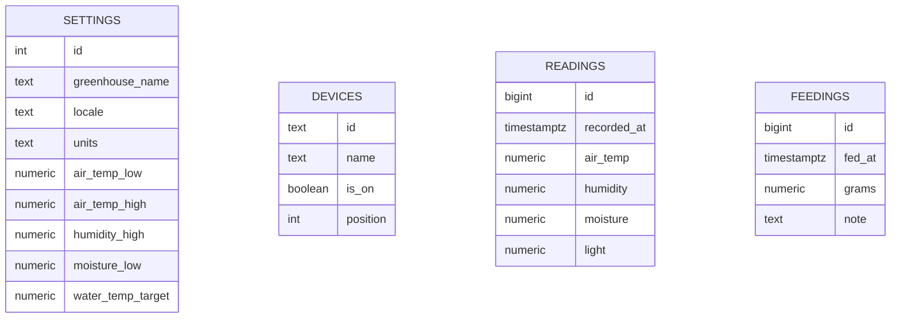

# AquaHydro

A phone app for one aquaponics greenhouse: a ranchu tank, grow beds, and the pumps between them.

Weeks 1–3 of the Smart Greenhouse plan:

| Week | What is ready | Where |
| --- | --- | --- |
| 1 Idea | Name, user, extra feature, modules, role | `docs/week-1-charter.md` |
| 2 Design | Colors, screens, data picture, stack, four walks | `docs/week-2-design.md` |
| 3 App | Every screen opens, and the numbers come from the database | This app, and `AquaHydro.apk` |

## Team

| Name | Role |
| --- | --- |
| Aruzhan | Idea, screens, design, and the written plan |
| Arnur | DB, backend |
| Arslan | Frontend, some help with backend |


## Install the APK

`AquaHydro.apk` sits next to this file. It is a debug build for a phone or an emulator, not a Play Store release. The sample greenhouse is packed inside, so the app opens with no server. The anon key is not in the APK. Editing a value in the Supabase console and pressing Refresh is the website, not this file.

On Windows, copy `AquaHydro.apk` to the phone and open it. If Android asks, allow install from that source. On an emulator, drag the file onto the emulator window.

Rebuild it with the Android SDK installed and `ANDROID_HOME` set:

```bash
npm run apk
```

## Run it

```bash
npm install
npm run dev
```

Open the app on your phone or in a narrow browser window. The first screen is the door. **Open the greenhouse** goes to the dashboard. The bottom bar is Devices, Home, Alerts, Care, Settings. **History** sits on the dashboard.

Without keys, the app reads the sample greenhouse in `src/data/seed.ts`. The sample is eight days of readings, five devices, one settings row, four feedings, a 45 °C air reading, and a 92% humidity reading.

`npm run check` confirms that sample. `npm test` is not a separate suite.

## Connect Supabase

The brief asks for Firebase or Supabase. Supabase is a Postgres database with a table editor, which is the console you open in the defense.

1. Create a project at [supabase.com](https://supabase.com).
2. Open the SQL editor and run `supabase/schema.sql`. That creates the tables and the same sample rows.
3. In Project Settings → API, copy the project URL and the `anon` public key.
4. Put them in `.env.local` (this file is gitignored):

```bash
SUPABASE_URL=https://YOUR-PROJECT.supabase.co
SUPABASE_ANON_KEY=your-anon-key
```

5. Restart `npm run dev`. Monitor then says the numbers come from Supabase.

Change a value in the table editor, go back to the app, and press **Refresh**. The screen follows the table. The current reading is the newest row in `readings`. A device pill follows `is_on`. The greenhouse name follows `settings.greenhouse_name`.

Use the anon key only. This project never uses the service role key.

## Screens

| Screen | What it shows |
| --- | --- |
| Door | Opens the greenhouse. Accounts are a later week. |
| Dashboard | Air, humidity, soil moisture, and light from the newest reading, plus the air chart. |
| Devices | Five devices and the stored on/off state. |
| History | Air and humidity for a day or a week. Open it from the dashboard. |
| Alerts | Readings outside the ranges in settings, including the 45 °C sample. |
| Care | The feeding log, and whether the fish were already fed today. |
| Settings | The settings row: name, language, units, ranges, and how long the history is. |

## Data structure

One greenhouse. No accounts yet, so there is no user table. History is not a separate table: it is every row in `readings`. The newest row is what Monitor shows now.



| Table | What it holds | This week |
| --- | --- | --- |
| `settings` | One row: name, language, units, and the ranges | Required |
| `devices` | One row per switch, with on/off | Five rows, three or more required |
| `readings` | One row per sample: air °C, humidity %, soil moisture %, light klux | Every 6 hours for 8 days, including 45 °C |
| `feedings` | One row per meal: time, grams, and a note | Four sample meals. Care reads this table. |

The anon key can read these tables and cannot write them. Writes happen in the Supabase table editor, which is the right place for this week's defense.

## Where the code lives

Screens never talk to Supabase.

- `src/data/supabase.ts` is the only file that connects. It reads `SUPABASE_URL` and `SUPABASE_ANON_KEY`.
- `src/data/index.ts` chooses Supabase when those two are set, and the sample otherwise.
- `src/data/seed.ts` is the sample.
- `src/data/ranges.ts` marks readings outside the settings ranges.
- `src/app/api/greenhouse/route.ts` is what the screens call.
- `src/components/` draws the screens.

## Stack

- **Next.js, React, and TypeScript.** The phone screens and the data API live in one project. `AquaHydro.apk` is the same screens installed on Android, which is what week 3 asks us to hand in.
- **Tailwind.** One set of colors and type on every screen: the greenhouse green, the leaf mark, Space Grotesk for titles, Inter for text.
- **Supabase.** The brief asks for Firebase or Supabase. The data is rows — readings, devices, settings — and the Supabase table editor is the console the defense asks you to open.

## Keys

Keys stay in `.env.local`. `.env.example` lists the names and has no values. If the anon key were committed, anyone could read the greenhouse tables. If the service role key were committed, anyone could change or delete them. Neither belongs on GitHub.

## Defense

1. Open `docs/week-1-charter.md` and say the name, the user, and the feeding log.
2. Open `docs/week-2-design.md` and walk the four paths in the app: dashboard, devices, alerts, then Care and History.
3. In Supabase, open Table Editor and show `readings`, `devices`, `settings`, and `feedings`.
4. Change the newest `air_temp`, or a device `is_on`, or a feeding note. Refresh the app and show the new value.
5. Show `src/data/supabase.ts` as the connection, and `.env.local` as the place the keys live. They are not in the repository.

Spoken answers:

- The app connects in `src/data/supabase.ts`. Screens only call `/api/greenhouse`.
- History is one row per sample in `readings`, ordered by `recorded_at`. The newest row is the current reading.
- A key on GitHub is a key anyone can use. The anon key would let people read the greenhouse. A service role key would let them rewrite it.
