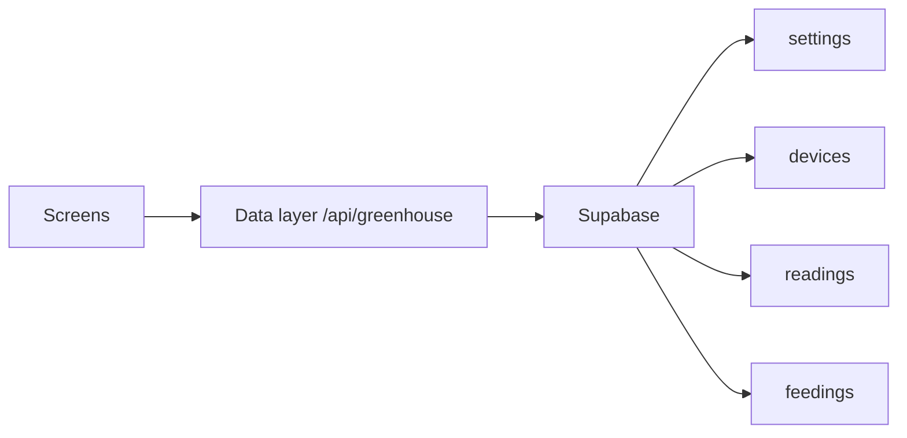

# AquaHydro — design

Week 2 of the Smart Greenhouse plan. This file is the style, the screen list, the data picture, and the tool choice. The clickable walkthrough is the app itself: every screen below opens from the phone navigation.

The course plan asks for a Figma link. There is no Figma account on this project, so the same screens are linked in the running app. Open the app and follow the four walks at the bottom of this file.

## Style

The user glances at a phone in a greenhouse and in a dim shed. The screen is dark, the numbers are large, and a warning is amber so it stands out from the plants and the water.

The logo is a small greenhouse frame with a water line and two fish. It is the mark on the door screen and in the side bar.

| Role | Color | Where |
| --- | --- | --- |
| Night green | `#0e1712` | Background |
| Card | `#16221b` | Panels |
| Mist | `#eaf2ed` | Text |
| Water | `#4fb3a9` | Buttons and the main line |
| Leaf | `#9ed968` | The name and the plant marks |
| Amber | `#e8a33d` | Anything outside the safe range |

Space Grotesk is the face for the name and the big numbers. Inter is the face for notes. The same colors and the same two faces are on every screen.

## Screens

| Screen | How you open it | What the farmer sees |
| --- | --- | --- |
| Login | The first screen | The name, the logo, and **Open the greenhouse**. Accounts come in a later week. |
| Dashboard | Home | Air, humidity, soil, light, the time of the reading, and the air chart. |
| Devices | Devices | Irrigation, ventilation, lights, the heater, and the feeder, each on or off. |
| History | **History** on the dashboard | Air and humidity for a day or a week, then the rows. |
| Alerts | Alerts | Readings outside the ranges, including 45 °C and 92% humidity. |
| Care | Care | The extra feature: whether the fish were fed today, and the stored meals. Short notes sit under the log. |
| Settings | Settings | The name, the language, the units, the ranges, and how long the history is. |

## Data

One greenhouse. History is not a separate table. It is every row in `readings`. The newest row is what the dashboard shows now.

| Table | What it holds |
| --- | --- |
| `settings` | One row: name, language, units, air range, humidity high, soil low, water target |
| `devices` | One row per switch, with on or off |
| `readings` | One row per sample: air °C, humidity %, soil %, light, and the time |
| `feedings` | One row per meal: time, grams, and a short note |

Screens never talk to Supabase. They ask `/api/greenhouse`. Only `src/data/supabase.ts` connects. The keys stay in `.env.local`.

### When the farmer presses Water

Irrigation is the water control.

This week the button does not write. The Devices screen reads `is_on` from the `devices` table. To change it in the defense, edit that cell in the Supabase table editor and press Refresh. The pill follows the row.

The later path, when control is built, is the same road with a write added:

1. The farmer presses Irrigation.
2. The screen asks the data layer for the new on or off.
3. The data layer writes `devices.is_on` for the irrigation row.
4. The screen reads that row again and shows On or Off.

Nothing else is written. A feeding is a different table. A reading is a different table.

## Stack

- **Next.js, React, and TypeScript.** The phone screens and the data request live in one project. The farmer opens it in the phone browser, and the same screens are packed into `AquaHydro.apk`.
- **Supabase.** The brief asks for Firebase or Supabase. The data is rows, and the Supabase table editor is the console the defense asks you to open.
- **Tailwind.** One set of colors and type, so a screen does not drift into a different style.

## Four walks

The course plan points at four scenarios in section 2 of the brief. That section was not in the file we have. These four walks cover the screens above. Use them in the design defense.

1. **Check the greenhouse.** Open the app. Press **Open the greenhouse**. Read the four numbers and the time.
2. **Check the water.** Open Devices. Show irrigation on or off, and say that the value is the stored `is_on`.
3. **See a bad day.** Open Alerts. Show the 45 °C row.
4. **Care, then the week.** Open Care and say whether the fish were already fed today. Go back to Home, press **History**, and switch Day and Week.
